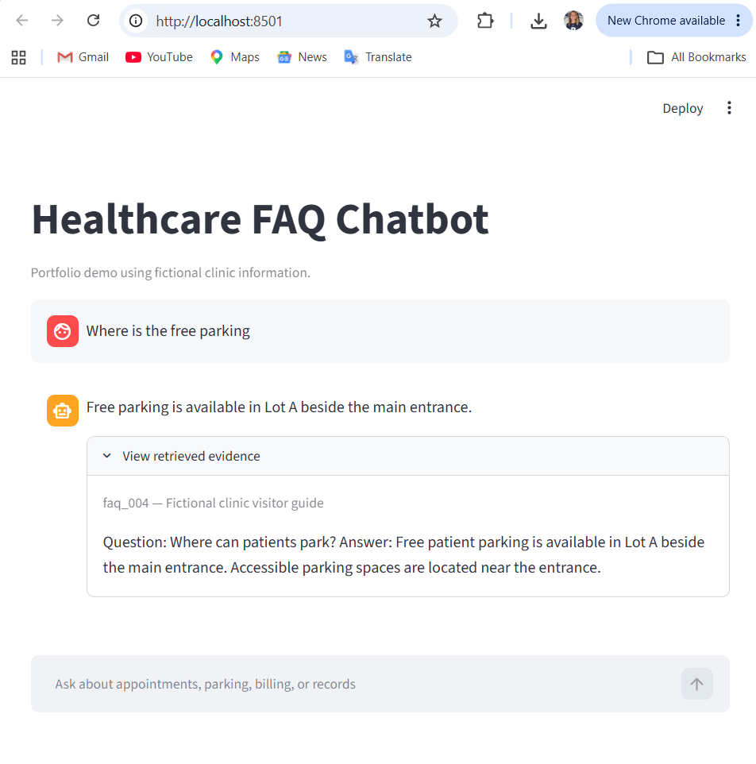

# Healthcare FAQ Chatbot

A simple local chatbot that answers questions using six fictional clinic FAQs. I built this project to practice retrieval-augmented generation (RAG) and understand how retrieved evidence affects a chatbot’s answers.

## Demo



## What it does

- Searches FAQs about appointments, visits, parking, billing, and medical records.
- Uses a local language model to generate short answers.
- Displays the retrieved evidence so users can check the response.
- Asks the model to acknowledge when information is missing.

All clinic information is fictional. This is a learning project, not a medical advice tool.

## How it works

1. Load the FAQs from a JSON file.
2. Create embeddings using Chroma’s default embedding function.
3. Store the documents and metadata in ChromaDB.
4. Retrieve the closest FAQ to the user’s question.
5. Send the question and retrieved passage to Llama through Ollama.
6. Display the answer and evidence in Streamlit.

The model is not trained on the FAQs. Relevant evidence is supplied with each question.

## Tools used

- Python
- ChromaDB
- Ollama
- Llama 3.2
- Streamlit
- Jupyter Notebook

The final chatbot uses `llama3.2:3b`. The notebook also includes experiments with `llama3.2:1b`.

## Project files

| File | Purpose |
|---|---|
| `healthcare_faq_chatbot.ipynb` | Data preparation, retrieval, generation, and experiments |
| `healthcare_faqs.json` | Fictional FAQ source data |
| `app.py` | Streamlit interface |
| `requirements.txt` | Python dependencies |
| `.gitignore` | Excludes local environments and generated files |

## Run the project

### 1. Set up Python

Download or clone this repository and open its folder in VS Code.

Create a virtual environment:

```powershell
python -m venv .venv
```

Activate it in Windows Command Prompt:

```bat
.venv\Scripts\activate.bat
```

Install the dependencies:

```powershell
python -m pip install -r requirements.txt
```

### 2. Set up Ollama

Install Ollama from https://ollama.com/download and keep it running.

Download both models to run all notebook examples:

```powershell
ollama pull llama3.2:1b
ollama pull llama3.2:3b
```

### 3. Build the FAQ database

Open `healthcare_faq_chatbot.ipynb`, select the `.venv` kernel, and run the cells from top to bottom.

This creates the local `chroma_db` folder. The database is generated locally and is not included in the repository.

The first embedding request may download the embedding model.

### 4. Start the interface

From the project folder, run:

```powershell
python -m streamlit run app.py
```

Open the Local URL shown in the terminal. Keep Ollama and the Streamlit terminal running while using the app.

## Example questions

- Where is free patient parking?
- How early should I arrive for my first visit?
- When is the billing office available?
- How long does a medical records request take?
- What is the Wi-Fi password at the clinic?

The Wi-Fi question tests missing information: the FAQs do not contain a password.

## What I learned

The biggest lesson was that correct retrieval does not guarantee a correct answer.

During testing, the smaller model sometimes refused to answer or contradicted the parking evidence. The larger model answered that example correctly.

In a separate four-question test, all four expected FAQs were retrieved first, but the model answered only three questions correctly. It incorrectly refused the booking question even though the retrieved FAQ contained scheduling instructions.

The model also correctly acknowledged that the retrieved evidence did not contain a Wi-Fi password.

These are small development tests, not a comprehensive accuracy benchmark.

## Current limitations

- The knowledge base contains only six fictional FAQs.
- The final workflow retrieves one FAQ per question.
- The model can still produce incorrect answers or unnecessary refusals.
- The interface does not retain chat history or understand follow-up references.
- Displaying retrieved evidence does not automatically verify the answer.
- Response speed depends on the computer running the model.

## Local demo

This app runs locally. Uploading the code to GitHub does not publish a live chatbot, and a `localhost` URL is not a public demo link.